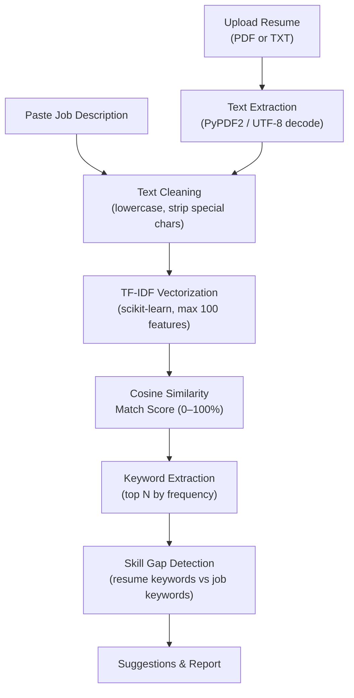

# 📄 AI Resume Screener

An intelligent resume analysis tool that matches your resume against a job description using **TF-IDF vectorization** and **cosine similarity**. Built with Streamlit, it helps job seekers identify skill gaps and improve their ATS (Applicant Tracking System) compatibility.

---

## ✨ Features

- 🎯 **Match Score Calculation** — Computes a percentage similarity between your resume and the job description
- 🔍 **Skill Gap Analysis** — Identifies skills present in the job description that are missing from your resume
- 📈 **Keyword Extraction** — Visualizes top keywords from both your resume and the job posting
- 💡 **Actionable Suggestions** — Provides personalized improvement recommendations based on your score
- 📥 **Downloadable Report** — Export a plain-text summary of the full analysis
- 📄 **Multi-format Support** — Accepts resumes in **PDF** and **TXT** formats

---

## 🛠️ Tech Stack

| Layer | Technology |
|---|---|
| Frontend / UI | [Streamlit](https://streamlit.io/) |
| NLP / ML | [scikit-learn](https://scikit-learn.org/) (TF-IDF, Cosine Similarity) |
| PDF Parsing | [PyPDF2](https://pypi.org/project/PyPDF2/) |
| Data Handling | [pandas](https://pandas.pydata.org/) |

---

## 📁 Project Structure

```
Resume Analyzer/
├── app.py            # Main Streamlit application
├── utils.py          # Core NLP and analysis helper functions
├── requirements.txt  # Python dependencies
└── README.md         # Project documentation
```

---

## 🚀 Getting Started

### Prerequisites

- Python 3.8 or higher
- pip

### Installation

1. **Clone the repository**
   ```bash
   git clone https://github.com/your-username/resume-analyzer.git
   cd resume-analyzer
   ```

2. **Create and activate a virtual environment** *(recommended)*
   ```bash
   python -m venv .venv

   # Windows
   .venv\Scripts\activate

   # macOS / Linux
   source .venv/bin/activate
   ```

3. **Install dependencies**
   ```bash
   pip install -r requirements.txt
   ```

4. **Run the app**
   ```bash
   streamlit run app.py
   ```

5. Open your browser and navigate to `http://localhost:8501`

---

## 📖 How It Works



1. **Text Extraction** — Reads text from an uploaded PDF or TXT resume file.
2. **Text Cleaning** — Lowercases text, removes special characters, and normalizes whitespace.
3. **TF-IDF Vectorization** — Converts both texts into weighted numerical vectors (top 100 features).
4. **Cosine Similarity** — Measures the angle between the two vectors to produce a match percentage.
5. **Keyword Analysis** — Extracts top keywords from each document and computes set differences to find gaps.
6. **Suggestions** — Generates tailored recommendations based on the match score and missing skills.

---

## 📊 Score Interpretation

| Score Range | Meaning |
|---|---|
| 🔴 0 – 29% | Low match — significant skill gaps; major resume revision recommended |
| 🟡 30 – 59% | Moderate match — some alignment; highlight more relevant experience |
| 🟢 60 – 100% | Strong match — good alignment; focus on emphasizing matching skills |

---

## 🖥️ App Interface

The app is organized into the following sections:

- **Sidebar** — Overview of the tool and supported formats
- **Upload Panel** — Upload your resume (PDF/TXT)
- **Job Description Panel** — Paste the target job description
- **Results Dashboard** — Four tabbed sections:
  - 🎯 **Overview** — Score, matching skills count, missing skills count
  - 🔍 **Skills Analysis** — Side-by-side tables of present and missing skills
  - 📈 **Keywords** — Bar charts of top keywords from resume and job description
  - 💡 **Suggestions** — Actionable tips and a downloadable report

---

## ⚙️ Configuration

No API keys or external services are required. The app runs entirely **offline** using local ML models.

You can tweak these values in `utils.py` to adjust analysis behavior:

| Parameter | Location | Default | Description |
|---|---|---|---|
| `max_features` | `calculate_match_score()` | `100` | Max TF-IDF vocabulary size |
| `top_n` | `extract_keywords()` | `15` | Number of top keywords to extract |
| Skill display limit | `app.py` (tabs) | `20` | Max skills shown in the UI table |

---

## 📦 Dependencies

```
streamlit
scikit-learn
pandas
PyPDF2
python-docx
```

Install all at once:
```bash
pip install -r requirements.txt
```

---

## 🤝 Contributing

Contributions are welcome! To get started:

1. Fork the repository
2. Create a feature branch: `git checkout -b feature/your-feature-name`
3. Commit your changes: `git commit -m "Add your feature"`
4. Push to the branch: `git push origin feature/your-feature-name`
5. Open a Pull Request

---

## 📄 License

This project is open-source and available under the [MIT License](LICENSE).

---

<div align="center">
  Made with ❤️ using Streamlit &nbsp;|&nbsp; AI Resume Screener v1.0
  <br/>
  <sub>This tool identifies skill gaps using TF-IDF based similarity analysis</sub>
</div>
